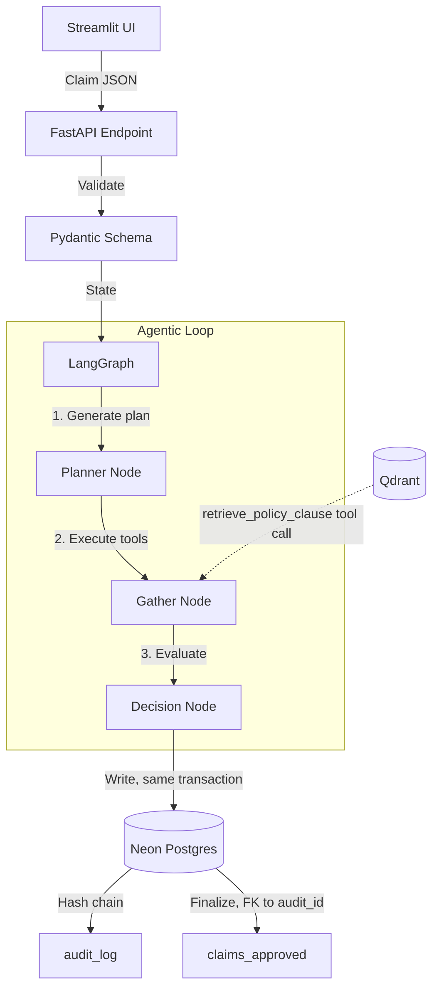

# RefundRx

**An auditable LLM agent that decides NHSBSA FP57 prescription-charge refunds, and is evaluated on how it decides, not just what it decides.**

[](https://github.com/Mprtham/RefundRX/actions/workflows/ci.yml)


> Demonstration system using synthetic data only. Not validated for clinical, regulatory, or GxP use. No real patient data is processed. Not indemnified for real decisions.

## The story

- **What:** RefundRx is an agent that decides FP57 refund claims. These come from patients in England who paid a prescription charge while they actually held an exemption (age, maternity, medical, HC2).
- **Why this domain:** UK pharmacies never refund dispensed medicines. They take them back for disposal only. The FP57 process is the refund that genuinely exists, and its rules are hard and checkable.
- **The need:** Every claim turns on four gates, and missing any one is a wrong payment:
  - an FP57 receipt issued *at the point of payment*, which can't be issued later
  - a claim made within three months less a day
  - a valid exemption
  - one refund per form
- **The gap:** Most agent demos check only the final answer. They can't show whether the agent planned sensibly, followed its own plan, or called the right tools. Their decisions also leave no record anyone could check afterwards.
- **How it's bridged:**
  - The flow is three LangGraph nodes: Planner → Gather → Decision.
  - The Planner generates an explicit plan, constrained to a Pydantic enum of six tools.
  - Gather executes that plan and logs every call, policy retrieval included.
  - Decision applies `policy_rules`, the only decision authority, and enforces the receipt hard gate whatever was planned.
  - Every decision is written to a SHA-256 hash-chained `audit_log`, in the same transaction as the approval.
- **The impact:** Ten hand-built DeepEval scenarios score tool correctness, plan quality and plan adherence on every push, against both SQLite and Postgres. A bad plan costs the agent on Plan Quality but never on patient safety.

**Scope:** exemption-category FP57 refunds only. PPC refunds and HC3 partial help are out of scope. Those claims get a clean 422 rejection and never crash the service.

## Architecture



| Piece | What it does |
|---|---|
| **Planner** | `openai/gpt-oss-120b` on Groq, pinned in `config/model_pin.yaml`. It outputs `{route, steps}` validated against a `ToolName` enum. If the plan omits `check_fp57_receipt`, it is kept as planned: that's a Plan Quality failure for the evals to catch, and nobody patches it. Without a Groq key, a deterministic `offline-reference-planner-v1` runs instead and is recorded as such in every audit row. |
| **Gather** | Executes the plan via the same enum. Tool arguments come from the validated request, never from the LLM or from retrieved text. Each tool has a **strict** Pydantic argument model, so a date passed as a string fails before the tool runs. It stops at the first failed check, and every call (name, args, result) goes into the trace. |
| **Decision** | Enforces the receipt hard gate, checks that every required check ran and passed, and computes the refund from the server-side charge constant. It then writes the audit row and, on approval, `claims` + `claims_approved` in **one transaction**. |
| **RAG** | NHSBSA guidance chunks embedded with `bge-small-en-v1.5` into Qdrant (local mode, rebuilt on startup). Scoring is hybrid: dense similarity plus IDF-weighted lexical overlap. It gets 10/10 on the tuning set and **6/8 on held-out questions**. Retrieved text fills only the citation. |
| **Audit** | `compute_audit_hash(prev, plan, trace, decision)` over canonical JSON (`sort_keys`, no whitespace) lives in `shared/audit_hash.py`. The Decision node and `scripts/verify_audit_chain.py` both import it. |

**Concurrency:** chain appends lock the head row with `SELECT … FOR UPDATE` after the LLM call and tool execution are done. A unique index on `COALESCE(prev_hash,'GENESIS')` also stops two concurrent appends forking the chain. This matters on an empty table, where there's no row to lock. On SQLite the same serialization comes from `BEGIN IMMEDIATE`. Tests fire 8 concurrent approvals, and 4 concurrent approvals of the same form, at both backends.

**Bugs the concurrency tests caught:**

1. **Chain fork at genesis.** On an empty `audit_log`, `SELECT … FOR UPDATE` has no row to lock, and a unique constraint on `prev_hash` lets multiple NULLs through. Two concurrent first decisions could therefore both become row 1. The fix is a unique index on `COALESCE(prev_hash,'GENESIS')` plus a retry with jitter, so the database itself refuses the fork.
2. **SQLite "database is locked".** A deferred transaction that reads the chain head and then writes fails immediately when it tries to upgrade its lock, and the busy timeout doesn't cover lock upgrades. The fix is to take the write lock at `BEGIN IMMEDIATE`, which is SQLAlchemy's documented recipe. Postgres keeps the `FOR UPDATE` path.

**Tamper-evident, scoped honestly:** the chain lives in the same database, so it detects casual edits but not an attacker with database access. The UI calls it *integrity-checked, not externally anchored*.

## Evaluation: ten scenarios

| # | Scenario | Key input | Expected decision | Executed trace |
|---|---|---|---|---|
| 1 | Eligible ✋ | valid ID, 10 days, HC2, receipt | APPROVED £9.90 | receipt → retrieve_policy → exempt → window → duplicate → calc |
| 2 | No receipt ✋ | receipt=false | REJECTED `NO_FP57_RECEIPT` | receipt (fails, hard gate) |
| 3 | Outside window ✋ | paid 95 days ago | REJECTED `OUTSIDE_CLAIM_WINDOW` | receipt → retrieve_policy → exempt → window (fails) |
| 4 | Wrong exemption | category with no active `policy_rules` row | REJECTED `EXEMPTION_NOT_IN_POLICY` | receipt → retrieve_policy → exempt (fails) |
| 5 | Duplicate | form ref already in `claims_approved` | REJECTED `DUPLICATE_CLAIM` | … → window → duplicate (app-level SELECT fails) |
| 6 | Info-only query | no claim | NO_CLAIM_MADE | retrieve_policy (Decision never runs) |
| 7 | API boundary | `patient_id` absent | HTTP 422 | none: rejected before the Planner, so Plan Quality/Adherence are N/A |
| 8 | Unknown patient | well-formed ID, not on file | REJECTED `UNKNOWN_PATIENT` | … → duplicate → calc (patient lookup fails) |
| 9 | Unpaid charge | `charge_payment_verified=false` | REJECTED `CHARGE_NOT_PAID` | … → duplicate → calc (payment verification fails) |
| 10 | Malformed LLM argument | date passed as `"2023-01-01"` | REJECTED `ARGUMENT_VALIDATION_FAILED` | … → window (strict validation fails, tool not run) |

✋ = expected answer hand-verified against the public NHSBSA guidance, not derived from `policy_rules`. This breaks the circularity of grading the agent against its own rule table.

**What runs where:**

- **CI, every push, SQLite and Postgres 16:**
  - decision and reason code
  - exact ordered trace, scored with DeepEval `ToolCorrectnessMetric`
  - plan quality: receipt check first, every required check planned
  - plan adherence: the executed trace is a prefix of the plan
  - audit-chain verification after every scenario

  CI also covers unit tests for window arithmetic (month-end and leap-year cases), hash canonicalization, tamper detection, a planner that skips the receipt check (Decision still rejects), and concurrency.
- **Locally, with a Groq key** (`GROQ_API_KEY=… DEEPEVAL_JUDGE=1 EVAL_PLANNER=groq pytest -m llm_judged`): DeepEval `PlanQualityMetric`, `PlanAdherenceMetric`, `FaithfulnessMetric` and GEval answer correctness. Their thresholds are the KPI targets.

**Sample size, honestly:** there are nine agent scenarios. A ≥90% target on n=9 has wide confidence intervals, so it is a demo-quality bar, not a statistically powered one.

### Notes on the build contract

These are the places where the spec left a choice open, and what was chosen:

- **Patient lookup and payment verification run inside `calculate_refund`.** The tool enum is fixed at six names, and a refund can only be calculated for a known patient with a verified payment. `check_duplicate` always runs before `calculate_refund`, so it shows up in the executed traces for scenarios 1, 8 and 9.
- **Scenario 4 uses a fixture `policy_rules` with no active `MEDICAL` row.** The API schema only admits the four in-scope categories, so a "category not in policy_rules" has to be one the schema accepts but the rule table doesn't currently authorize.
- **Scenario 10 injects the malformed argument through a test-only hook (`arg_overrides`).** The hook isn't reachable from the API. In production, tool arguments come from the validated request.
- **`patients` on file means present in `claims` history.** This keeps the four-table schema. Only approved submissions are written to `claims`, so a rejected unknown patient doesn't become "known".
- **Informational answers are not decisions, so they aren't written to `audit_log`.** Every claim decision is, including planner failures, which are recorded as `PLANNING_FAILED` rejections.

## Run locally

```bash
python -m venv .venv && . .venv/bin/activate   # Windows: .venv\Scripts\activate
pip install -r requirements-dev.txt
python -m scripts.generate_synthetic_data && python -m scripts.seed_db
uvicorn app.main:app --port 8000               # set GROQ_API_KEY in .env to use the LLM planner
streamlit run ui/streamlit_app.py              # second terminal
pytest                                         # 10 scenarios + unit tests
```

`python -m scripts.verify_audit_chain` checks the chain from the command line. Deployment to Render (API + UI, Neon Postgres) is described in `render.yaml`, and `.github/workflows/keep_alive.yml` pings the UI's `/_stcore/health` every 10 minutes; the API wakes on first use.

Data provenance (what's real, what's synthetic) is in [`data/README.md`](data/README.md).

**Policy sources.** The time limit follows the [NHSBSA FAQ](https://faq.nhsbsa.nhs.uk/knowledgebase/article/KA-01518/en-us) ("within 3 months less a day from the date the prescription charge was paid"). The no-FP57 rule follows [NHSBSA KA-03919](https://faq.nhsbsa.nhs.uk/knowledgebase/article/KA-03919/en-us), and the claim procedure follows [Community Pharmacy England](https://cpe.org.uk/dispensing-and-supply/prescription-processing/receiving-a-prescription/patient-charges/refunds/). The £9.90 charge was frozen for 2026/27 (DHSC, 21 Nov 2025). Income Support and income-based JSA stopped being exemption categories on 15 April 2026. Where the sources are silent, `policy_docs/fp57_guidance.md` marks the clause as a **System rule** (for example, one refund per FP57).

---
*Designed and built by **Prathamesh Mishra**.*
